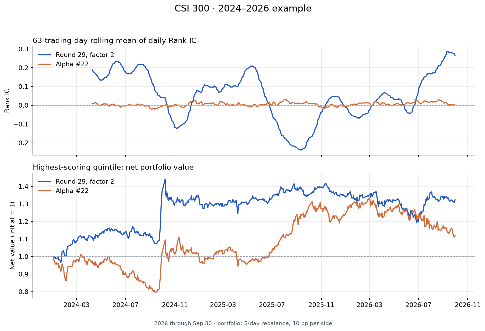

# Quantlite

A lightweight agent framework for researching quantitative factors with LangGraph and Qlib.

Given a research direction, Quantlite generates a hypothesis and factor formulas, evaluates them on local market data, and uses recent feedback to guide the next round.

## Workflow

```text
Research direction → Hypothesis → Factor formulas → Evaluation → Feedback → Next round
```

Each round generates two factors. The evaluator calculates daily cross-sectional IC and Rank IC; the agent receives detailed feedback from the latest six rounds. Full experiment records are saved locally.

## Setup

Python 3.11 and local Qlib-format market data are required.

```bash
python3.11 -m venv .venv
source .venv/bin/activate
pip install -r requirements.txt
cp .env.example .env
```

Set `OPENAI_API_KEY` in `.env`, then configure the research direction, model, number of rounds, and Qlib data path in `configs/research.yaml`. Market data and experiment outputs are not included in this repository.

## Run

```bash
# Preview prompts without calling the API or loading market data
python -m lite --loop --dry-run

# Start a new research run
python -m lite --loop --env-file .env

# Resume a previous run
python -m lite --resume runs/YOUR_RUN_ID --env-file .env
```

The loop currently evaluates historical CSI 300 constituents over 2020–2023 using 21-trading-day forward returns. The terminal prints each formula and its yearly Rank IC. Results are stored under `runs/`.

## Example result

One run produced a factor combining low price variability with a price–volume interaction. Below is an illustrative comparison against Alpha #22 from WorldQuant’s [*101 Formulaic Alphas*](https://arxiv.org/abs/1601.00991) on historical CSI 300 constituents. The candidate was selected using 2020–2023 exploration results.



| Metric | Round 29, factor 2 | Alpha #22 |
|---|---:|---:|
| Mean Rank IC, 2024 | 0.1201 | 0.0026 |
| Mean Rank IC, 2025 | -0.0401 | 0.0059 |
| Mean Rank IC, 2026 through September | 0.1517 | 0.0088 |
| Mean Rank IC, full period | 0.0703 | 0.0055 |
| Q5 net value, 10 bp per side | 1.3228 | 1.1193 |
| Q5 annualized return | 11.17% | 4.36% |
| Q5 maximum drawdown | -17.13% | -21.40% |

Example data: [`docs/example_daily.csv`](docs/example_daily.csv). Figure script: [`docs/plot_example.py`](docs/plot_example.py).

## Tests

```bash
python -m unittest discover -s tests -v
```

Tests use mock model responses and synthetic data; they do not call the API.

## Acknowledgment

Inspired by and based in part on [QuantaAlpha](https://github.com/QuantaAlpha/QuantaAlpha). The prompt source is documented in `prompts/source.json`.

This is a research tool. Factor results are exploratory and do not establish future performance.
